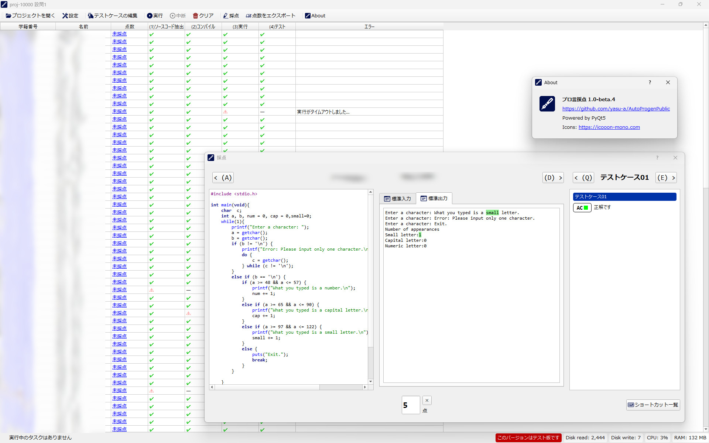

# AutoProgen

プロ言の提出物の採点を効率化するためのツールです。

> [!IMPORTANT]
> このツールは採点を支援するためのものです。
> 開発者はツールの不具合で生じた採点ミスに責任を負いません。
>
> 最終的な点数を使用者が十分に検討した上でご利用ください。

> [!IMPORTANT]
> 利用者への対応が難しくなるので、二次配布はご遠慮ください。GitHubへのリンクをご利用ください。

> [!CAUTION]
> このツールを実行すると悪意のある提出コードによる任意コード実行の可能性があります。学生を信じましょう。

# 確認済み動作環境

- Windows 11
- Python 3.11～3.14

[変更履歴](CHANGELOG.md)

# 使用技術

- [Python](https://www.python.org/)
- [PyQt5](https://pypi.org/project/PyQt5/)
- [SQLite](https://www.sqlite.org/)
- [Visual Studio Developer Command Prompt](https://learn.microsoft.com/ja-jp/visualstudio/ide/reference/command-prompt-powershell)

# 開発・コントリビューション

- 不具合報告や機能提案を行う前に、[コントリビューションガイド](CONTRIBUTING.md)を確認してください。
- 未公開の脆弱性は公開Issueへ投稿せず、[セキュリティポリシー](SECURITY.md)に従ってください。
- 開発課題と対応状況は[GitHub Issues](https://github.com/yasu-a/AutoProgenPublic/issues)で管理します。

# FAQ

### **どうやって使うの？**

[チュートリアル](docs/tutorial.md)を参照してください。

### **コンパイルがタイムアウトする**

[実行環境の性能に応じた設定のチューニング](docs/tutorial.md#実行環境の性能に応じた設定のチューニング)を参照してください。

### **実行がタイムアウトする**

生徒のプログラムの実行が（正常終了か異常終了かにかかわらず）停止しないで動き続けているときに発生します。

次の理由が考えられます：

- **生徒のプログラムが入力を待ち続けています。**
  テストケースを確認してください。
  例えば、コンソール上でEnterキーを押下する場所では、テストケースの入力文字列に改行を挿入する必要があります。
  テストケースが正しい自信があるなら、生徒のプログラムに原因があります。
- **生徒のプログラムが無限ループにはまっています。**
  この場合は生徒のプログラムに原因がありそうですが、テストケースの入力に間違いがないか確認する必要があるかもしれません。
- **実行時間が足りません。**
  プログラムの計算量や実行環境の性能によっては時間内に実行が終了しない可能性があります。
  実行のタイムアウトの設定は、テストケース編集画面の「実行の構成」タブ→「実行のオプション」→「実行のタイムアウト（秒）」を参照してください。

### **ツールが落ちた・急に画面が消えて終了した**

バグでクラッシュしています。

もし時間があれば、[run.bat](run.bat)で起動する代わりに[run-debug.bat](run-debug.bat)で起動し、
バグを再現し、クラッシュしたときにコマンドプロンプトに表示されるエラーログを開発者に送ってやってください。
[run-debug.bat](run-debug.bat)で起動すると、プロセスの終了後もすぐにコマンドプロンプトが消えなくなります。

### **run.batをクリックすると一瞬で画面が消えて起動できない / 対応するPythonが見つからないと言われる**

[ツールの起動 - 初回](docs/tutorial.md#初回)を確認してください。

AutoProgenはPython 3.11～3.14に対応しています。Python 3.10以前や3.15以降だけがインストールされている環境では起動できません。

`run.bat`は既存の`.venv`を最初に確認し、存在しない場合はWindowsの`py`コマンド、PATH上の`python`コマンドの順に対応するPythonを探します。コマンドプロンプトで`py -0p`または`python --version`を実行し、対応するPythonが利用できるか確認してください。

既存の`.venv`が壊れている、または対応範囲外の場合は、自動的には削除されません。画面の案内に従って`.venv`を削除または別名へ変更してから、もう一度`run.bat`を実行してください。
